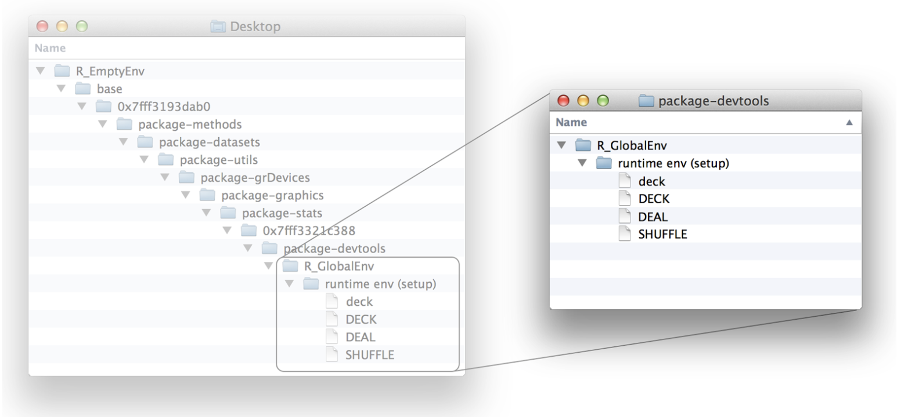
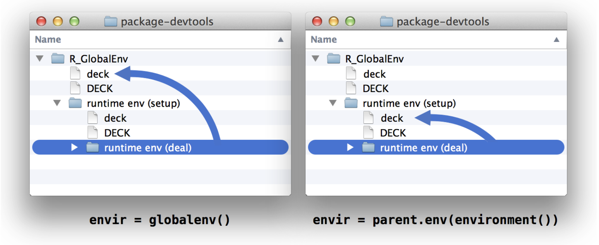

```{r}
deck <- read.csv("data/deck.csv")
deck
```

```{r}
# get the first row / first cards in the deck
deal <- function(cards) {
  cards[1, ]
}
deal(deck)
```

```{r}
deck2 <- deck[1:52, ]
deck2
```

```{r}
deck3 <- deck[c(2, 1, 3:52), ]
deck3
```

```{r}
# shuffle the deck
random <- sample(1:52, size = 52)
random
deck4 <- deck[random, ]
deck4
```

```{r}
# create a function for shuffle
shuffle <- function(cards) {
  random <- sample(1:52, size = 52)
  cards[random, ]
}

# now you can shuffle the deck each time you draw the first/top card in the deck
deal(deck)
deck2 <- shuffle(deck)
deal(deck2)
```

# Modifying values

```{r}
## keep a clean copy of the deck, and work on another copy deck2
deck2 <- deck
```

## Game of WAR

In the game of WAR, aces receive the highest value of all the cards, which would be something like 14. To change the their value from 1 to 14, we know where (as long as the deck has not been shuffled) aces are. they appear in every 13 cards.

```{r}
deck2[c(13, 26, 39, 52), ]
```

```{r}
# change the value of aces to 14
deck2[c(13, 26, 39, 52), "value"] <- 14
deck2$value[c(13, 26, 39, 52)] <- c(14, 14, 14, 14) # a different way for the same thing
deck2$value[c(13, 26, 39, 52)] <- 14 # likewise

deck2[c(13, 26, 39, 52), ]
```

the above method of assigning a new value is not convenient because every time you shuffle the deck you would have to look through all the cards and note the the location of all aces. Using "logical subsetting" is the way to go.

```{r}
deck2$value[deck2$face == "ace"] <- 14
```

```{r}
deck2[deck2$face == "ace", ]
```

## Game of HEARTS

every card has a value of zero EXCEPT cards in suit of `hearts`, which have a value of 1, AND the queen of spades, which is worth 13 points.

```{r}
# first
deck3 <- deck
deck3$value <- 0 # every card value assigned to zero
# second
deck3$value[deck3$suit == "hearts"] <- 1 # cards in suit of hearts assigned to 1
# third
deck3$value[(deck3$face == "queen") & (deck3$suit == "spades")] <- 13
```

```{r}
deck3
```

## Exercise

```{r}
w <- c(-1, 0, 1)
x <- c(5, 15)
y <- "February"
z <- c("Monday", "Tuesday", "Friday")
```

Questions:

Is w positive?

Is x greater than 10 and less than 20?

Is object y the word February?

Is every value in z a day of the week?

```{r}
w > 0
x > 10 & x < 20
y == "February"
all(z %in% c("Monday", "Tuesday", "Wednesday", "Thursday", "Friday", "Saturday", "Sunday"))
```

## Game of BLACKJACK

- each number card has a value equal to its face value.
- each face card (king, queen, or jack) has a value of 10.
- each ace has a value of 11 or 1, depending on the final results of the game

```{r}
deck4 <- deck
```

```{r}
deck4$value[deck4$face %in% c("king", "queen", "jack")] <- 10

head(deck4)
```

```{r}
deck4[deck4$face == "ace", ]
```

```{r}
## set ace values to NA
deck4$value[deck4$face == "ace"] <- NA

head(deck4, 13)
```

# Environments

```{r}
library(rlang)
env_parents()
```

```{r}
as.environment("package:stats")
```

```{r}
base::globalenv()
rlang::global_env()
```

```{r}
parent.env(globalenv())
parent.env(global_env())
```

```{r}
base::emptyenv()
rlang::empty_env()
```

```{r}
ls(emptyenv())
```

```{r}
ls(globalenv())
```

```{r}
# to see the current active environment
environment()
```

## Evaluation

```{r}
show_env <- function(){
  list(ran.in = environment(), 
       parent = parent.env(environment()), 
       objects = ls.str(environment()))
}

show_env()
```

```{r}
foo <- "take me to your runtime"

show_env <- function(x = foo){
  list(ran.in = environment(), 
       parent = parent.env(environment()), 
       objects = ls.str(environment()))
}

show_env()
```

## now back to playing cards

```{r}
# the intact version of deck
DECK <- deck
  
deal <- function() {
  card <- deck[1, ]
  # see comment below
  assign("deck", deck[-1, ], envir = globalenv())
  card
}
```

comment: why we use `assign()` in the above `deal()` function instead of just: `deck <- deck[-1, ]`. Reason: the orginal `deck` object resides in the Global environment, however when R evaluates a function it creates a "runtime environment" under the active env (Globalenv), so `deck <- deck[-1, ]` inside the function would create a new `deck` object inside that runtime env, and the actual `deck` object in the global env would remain intact. That's why, to change the `deck` in the global env, we need to use the `assign()` function by pointing the `globalenv()`.

```{r}
# rewrite the shuffle function
shuffle <- function() {
  random <- sample(1:52, size = 52)
  assign("deck", DECK[random, ], envir = globalenv())
}
```

## Closures

Our system finally works. But the system requires `deck` and `DECK` to exist in the global environment. Lots of things happen in this environment, and it is possible that `deck` may get modified or erased by accident.

It would be better if we could store `deck` in a safe, out-of-the-way place, like one of those safe, out-of-the-way environments that R creates to run functions in. In fact, storing `deck` in a runtime environment is not such a bad idea.

You could create a function that takes `deck` as an argument and saves a copy of `deck` as `DECK`. The function could also save its own copies of `deal` and `shuffle`:

```{r}
setup <- function(deck) {
  DECK <- deck

  DEAL <- function() {
    card <- deck[1, ]
    assign("deck", deck[-1, ], envir = globalenv())
    card
  }

  SHUFFLE <- function(){
    random <- sample(1:52, size = 52)
    assign("deck", DECK[random, ], envir = globalenv())
 }
}
```



```{r}
setup <- function(deck) {
  DECK <- deck
  
  DEAL <- function() {
    card <- deck[1, ]
    assign("deck", deck[-1, ], envir = globalenv())
    card
  }
  
  SHUFFLE <- function(){
    random <- sample(1:52, size = 52)
    assign("deck", DECK[random, ], envir = globalenv())
  }
  
  list(deal = DEAL, shuffle = SHUFFLE)
}

cards <- setup(deck)
```

```{r}
deal <- cards$deal
shuffle <- cards$shuffle
```

```{r}
deal
```

```{r}
shuffle
```

However, the functions now have one important difference. Their origin environment is no longer the global environment (although `deal` and `shuffle` *are* currently saved there). Their origin environment is the runtime environment that R made when you ran `setup`. That’s where R created `DEAL` and `SHUFFLE`, the functions copied into the new `deal` and `shuffle`, as shown in:

```{r}
environment(deal)
environment(shuffle)
```

This arrangement is called a *closure*. `setup`’s runtime environment “encloses” the `deal` and `shuffle` functions. Both `deal` and `shuffle` can work closely with the objects contained in the enclosing environment, but almost nothing else can. The enclosing environment is not on the search path for any other R function or environment.

You may have noticed that `deal` and `shuffle` still update the `deck` object in the global environment. Don’t worry, we’re about to change that. We want `deal` and `shuffle` to work exclusively with the objects in the parent (enclosing) environment of their runtime environments. Instead of having each function reference the global environment to update `deck`, you can have them reference their parent environment at runtime, as shown in the figure below:



```{r}
setup <- function(deck) {
  DECK <- deck
  
  DEAL <- function() {
    card <- deck[1, ]
    assign("deck", deck[-1, ], envir = parent.env(environment()))
    card
  }
  
  SHUFFLE <- function(){
    random <- sample(1:52, size = 52)
    assign("deck", DECK[random, ], envir = parent.env(environment()))
  }
  
  list(deal = DEAL, shuffle = SHUFFLE)
}

cards <- setup(deck)
deal <- cards$deal
shuffle <- cards$shuffle
```

We finally have a self-contained card game. You can delete (or modify) the global copy of `deck` as much as you want and still play cards. `deal` and `shuffle` will use the pristine, protected copy of `deck`:

```{r}
rm(deck)
shuffle()
deal()
```

```{r}
deal()
```

```{r}
ls.str(environment(deal))
```
